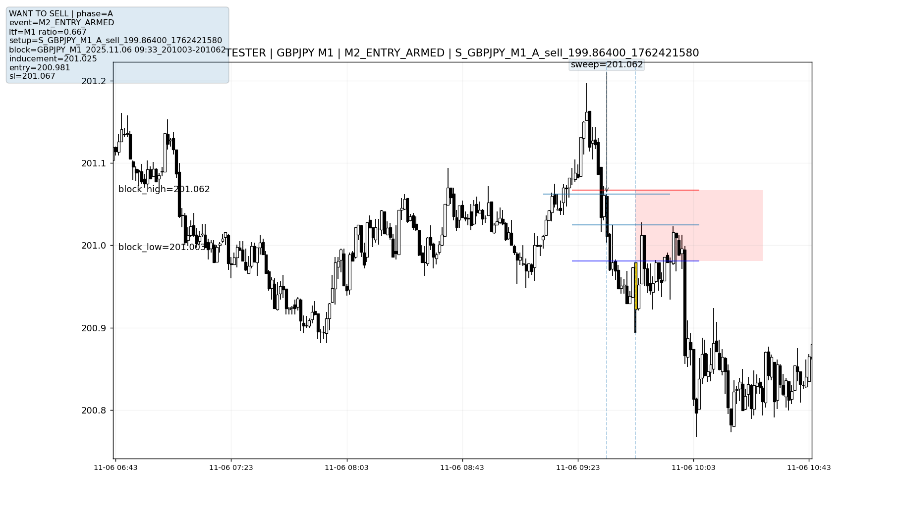

# MBFX Trading Research

**System Design | Data Analysis | Testing | Research**

An independent project developed over approximately 20 months to turn a manually traded financial strategy into an automated system, investigate its behaviour and test whether it demonstrated a genuine advantage.

What began as a trading algorithm grew into a substantial research framework, combining MQL5 and Python with event logging, structured datasets, annotated charts and historical testing.

| Project scale | Approximate figures |
|---|---|
| Time invested | 3,000 hours over 20 months |
| Original technical specification | 12,000 words |
| MQL5 and Python codebase | 35,000 lines |
| Research dataset | 900 fields |

## What This Project Demonstrates

The project involved requirements analysis, system design, data processing with Python, software testing, defect investigation and independent research.

The five case studies below explain specific problems I investigated, how I approached them and the evidence behind the findings. Each is written to be understandable without a background in trading.

| Case Study | What I Did | Skills Demonstrated |
|---|---|---|
| **[01. System Design](case-studies/01-system-design.md)** | Turned a complex manual process into defined requirements and a modular software system. | Requirements analysis, system design, problem solving |
| **[02. Testing and Debugging](case-studies/02-module2-investigation.md)** | Investigated incorrect software behaviour using logs, code analysis and visual evidence generated by Python. | QA testing, root cause analysis, debugging, technical investigation |
| **[03. Data Collection and Quality](case-studies/03-data-quality.md)** | Developed structured research datasets and investigated missing, duplicated and inconsistent information. | Python, data processing, data validation, reporting |
| **[04. Regression Testing](case-studies/04-regression-testing.md)** | Compared historical test runs to measure the effects of changes, identify performance regressions and investigate unexpected results. | Regression testing, performance analysis, comparative testing |
| **[05. Research Methodology](case-studies/05-research-methodology.md)** | Designed research experiments, evaluated competing hypotheses and tested findings against comparison groups. | Independent research, experimental design, statistical analysis, critical evaluation |

The case studies contain supporting code, datasets, historical test results and explanations of the limitations identified during the investigations.

## Research Tools and Workflow

## The Original Challenge

My trading approach relied on interpreting price charts, identifying certain patterns and using judgement to decide whether a trade should be taken. I wanted to find out whether that process could be automated and whether the strategy was genuinely effective.

This presented two separate challenges:

- **Building the system:** Turning subjective trading decisions into clear rules that a computer could follow.
- **Testing the system:** Establishing whether those rules were being followed correctly and whether historical results were reliable.

As the project progressed, much of my work shifted towards investigating unexpected behaviour, improving data collection and developing ways to test the results more thoroughly.

## How the Project Developed

### 1. Turning the Strategy into a Working System

I began by writing an approximately 12,000 word specification, breaking the trading strategy into individual rules, conditions, calculations and expected outcomes. This provided the framework for a modular trading system built in MQL5 with coding that was assisted by AI.

I directed the development of each module, testing and compiling components as they were introduced rather than waiting until the entire system was completed. I also incorporated controls that allowed individual conditions to be enabled or disabled, helping isolate particular behaviours during testing.

### 2. Building Tools to Investigate Incorrect Behaviour

One of the biggest challenges involved Module 2, which identified price patterns and potential trading locations. The system could report where it had detected a pattern, but the numerical outputs alone couldn't tell me whether it was actually identifying what I intended.

To investigate this, I developed an additional research workflow using Python to record important events and generate annotated charts. These charts showed the system's behaviour alongside historical price movements across multiple timeframes.

This allowed me to visually compare what the system was supposed to identify against what it was actually identifying, uncovering issues that were difficult to recognise from logs alone.

### 3. Building the Data Collection and Reporting System

Visual verification was useful for individual examples, but manually examining hundreds of charts wasn't an effective way to identify larger patterns. I expanded the research infrastructure to record events throughout the trading process and process them into structured CSV datasets.

These datasets captured hundreds of details, including detected patterns, validation decisions, rejected opportunities and trade outcomes. I used the information to investigate where trades were failing, identify recurring problems and decide which parts of the system needed further testing.

The reporting process also required data quality checks. These included investigating duplicate records, missing values and incorrect event sequences. In one investigation, I chose to leave fields blank rather than populate them with values that weren't supported by genuine recorded data. This increased reported missingness but avoided presenting misleading information as complete.

### 4. Baseline Testing and Root-Cause Investigation

I developed a repeatable testing process:

**Define the expected result → Isolate the relevant condition → Run a historical test → Examine the data and charts → Investigate discrepancies → Make changes → Retest**

I used historical backtests as baselines to assess how changes affected system behaviour and performance. One October test increased a simulated £10,000 account to £12,695.80, a gain of approximately 26.96%. However, other testing periods produced substantially weaker results, demonstrating why one successful backtest could not establish a reliable strategy.

The investigations weren't limited to trading results.

For example, expanding historical candle exports increased a four day test from approximately 70 seconds to five or six minutes. This led to changes in the amount of data exported, which required balancing the information needed for analysis against the slower performance of the testing process.

Other investigations involved unexpected calculations, duplicate detections, inconsistent records and differences between intended and actual system behaviour.

### 5. Testing Whether the Strategy Actually Had an Advantage

As the system became more measurable, I increasingly questioned whether apparently promising results represented a genuine statistical advantage. This involved comparing results against alternative explanations and baseline scenarios, examining the influence of different conditions and looking for weaknesses in the research methodology.

I also used multiple AI systems to review parts of the work, challenge assumptions and identify possible sources of bias, alongside my own investigations. Later research included comparisons with ordinary or randomly selected reference levels rather than assuming that the levels identified by the system were inherently more predictive.

**The research ultimately did not establish a reproducible profitable trading edge.** Although disappointing, this was an important conclusion. Positive individual backtests were not sufficient evidence when the broader testing failed to support them.

## Example: Visual Verification of a Trading Decision

During testing, I needed to understand why the system was making particular decisions rather than relying solely on numerical logs. I used Python to generate annotated charts showing the recorded event, proposed trading area, entry parameters and surrounding historical price movements. This allowed me to visually compare the system's decisions against the original trading rules and investigate cases where the behaviour appeared incorrect.

*GBPJPY example: A Python generated chart showing where the system identified a potential trade, the recorded entry and risk levels, and how the price behaved afterwards. This helped me visually check the system's decisions against the original trading rules.*

## My Role and the Use of AI

I was responsible for defining the trading methodology, writing the original requirements, directing development, designing tests, investigating discrepancies and interpreting the research findings. AI assistance was used extensively to write and modify MQL5 and Python code and troubleshoot technical problems. It was also used to review small aspects of the research.

## Research Outcome and Limitations

MBFX developed into a substantial research and testing system, but the underlying trading strategy did not demonstrate a reliable, reproducible advantage. Some implementation issues also remained unresolved. Historical simulations do not establish live profitability, and the project was not validated through forward trading.

The portfolio focuses on the systems built, the problems investigated, the evidence collected and the conclusions drawn rather than presenting an unsuccessful trading strategy as a commercial success.
