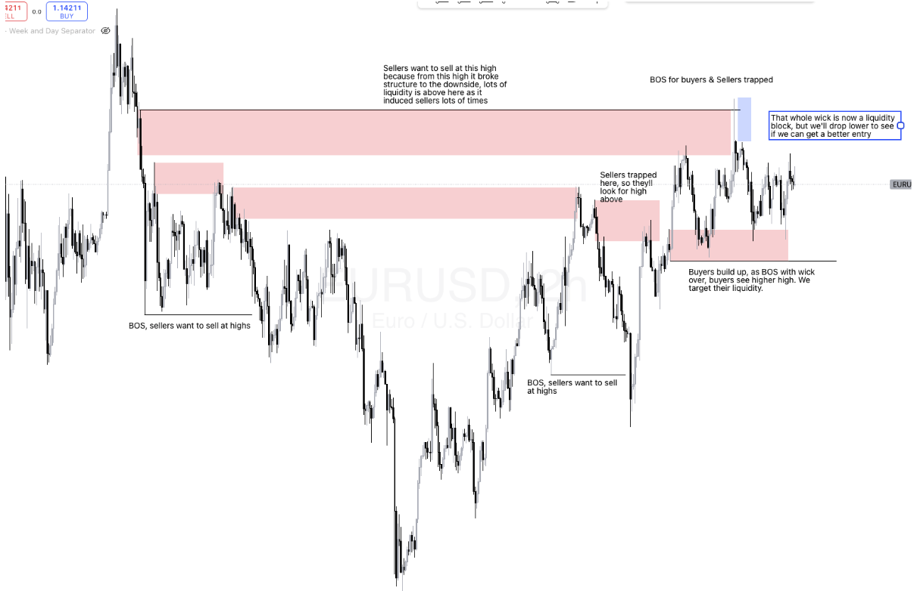
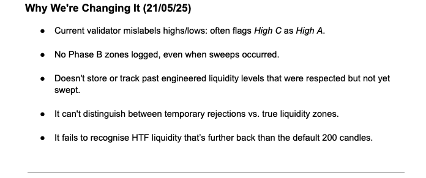
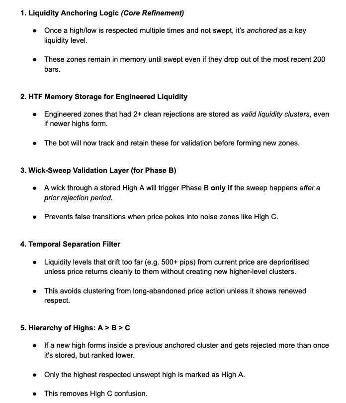
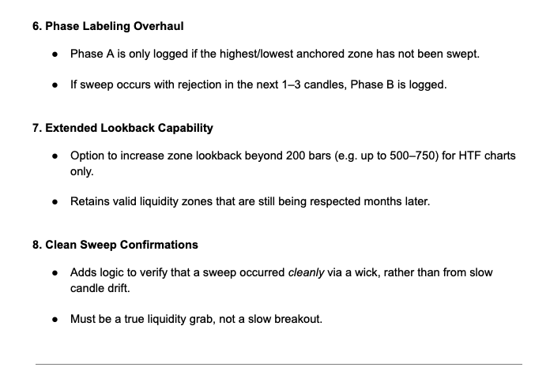

# 01. Turning a Trading Strategy into Testable Requirements

**Focus:** Requirements analysis, system design, test planning and defect investigation

## The Original Problem

My trading strategy relied on interpreting financial charts, identifying patterns and using judgement to decide whether a trade was worth taking. I wanted to automate the process, but many of the decisions I made manually were difficult to explain in precise terms. Instructions such as "look for a strong rejection" or "wait for the market to align" might make sense to an experienced trader, but they aren't specific enough for software to follow consistently. The first challenge was therefore to turn those judgements into clear rules that could be implemented, measured and tested.

## Defining the Requirements

I developed an approximately 12,000-word working specification covering the trading methodology, expected system behaviour, entry conditions, risk controls, exceptions and data recording requirements. I also used annotated charts to illustrate the behaviours I wanted the system to recognise. Rather than only describing what a valid trading setup looked like, I needed to define the conditions that would qualify or disqualify it.

### Example 1: Turning subjective judgements into measurable rules

One part of the strategy involved identifying important price levels that the market had repeatedly reacted to. Manually, I could distinguish a meaningful level from an isolated price movement. To automate that judgement, I defined more specific conditions.

| Original judgement | Defined requirement |
|---|---|
| A price level has been respected several times | Require at least two meaningful touches with clear separation |
| The reactions are close enough to belong to the same area | Use volatility based tolerances, adjusted for the market and timeframe |
| An older level is still relevant | Retain valid levels and apply rules for when they become stale |
| A price level has been taken out | Require an actual break of the relevant level, rather than a near miss |
| Conditions aren't strong enough for entry | Reject the setup when required confirmations are missing |

*An annotated chart from the original specification showing how I identified repeated price reactions and relevant market levels. These visual observations helped define the rules the automated system needed to follow.*

The specification also introduced different distance thresholds depending on the timeframe. For example, shorter timeframe levels used tighter limits than daily levels. These definitions gave the software measurable conditions to evaluate and provided a basis for checking whether its decisions matched the intended rules.

## Designing the System

I divided the project into five main modules so that each part of the trading process had a defined responsibility.

| Module | Responsibility |
|---|---|
| M1 | Identify and validate important market levels |
| M2 | Detect potential trading setups |
| M3 | Validate proposed entries and calculate risk |
| M4 | Check execution conditions and simulate orders |
| M5 | Record and analyse trade outcomes |

I directed the development through the specification, defined the required behaviour and tested components as they were introduced. The modular design also allowed individual conditions to be isolated during later investigations. This became important when the system produced unexpected results. Rather than treating every problem as an issue with the entire strategy, I could focus on the relevant module and investigate which conditions were responsible.

## Refining Requirements During Development

The original specification was not static. I added clarifications and changes as development exposed problems or behaviours that hadn't been adequately defined.

### Example 2: Investigating incorrect market level detection

A documented Module 1 review from May 2025 identified several issues with the existing validator.

These included selecting the wrong reference level, failing to identify certain changes in market conditions and losing track of older levels that could still be relevant. The review led to more detailed requirements.

| Identified problem | Required change |
|---|---|
| Incorrect reference level selected | Distinguish meaningful levels from smaller or irrelevant price movements |
| Older levels lost from consideration | Store and retain previously validated levels |
| Changes in market conditions not identified correctly | Refine the rules controlling when the system changes state |
| Limited historical lookback | Extend the data considered when validating older structures |

### Original evidence: Module 1 investigation

The following extracts are from my working specification, dated 21 May 2025. They document problems identified with the existing implementation and the changes I proposed.

**Problems identified**

**Proposed improvements**

This was an example of **defect investigation leading to a requirements change**. The important distinction was between what I expected the system to detect and what the existing implementation was reporting. Documenting those differences helped define the changes that needed implementing and checking. The written review establishes the identified issues and proposed corrections. The results of implementation and subsequent testing require separate evidence.

## Designing for Exceptions and Testing

A trading system needs to handle more than ideal examples. The specification included edge cases where price might nearly reach a level without breaking it, where a valid looking setup lacked another required confirmation, or where the market moved in a way that invalidated the original conditions. For each situation, I needed to decide whether the system should continue monitoring, reject the setup or reassess its original assumptions. These became important parts of the test design.

### Example 3: Defining what should happen when conditions fail

One rule addressed a situation where price breaks an important level but the smaller timeframes do not show the required confirmation. The expected behaviour was to **reject the potential trade rather than proceed based on the initial signal alone**. That gave me a specific behaviour to check during testing. The same principle applied to other exceptions: a condition passing in one part of the system should not override a separate requirement that had failed.

## Making Decisions Traceable

The specification also included an audit and logging plan. I wanted to understand why the system made a decision, not simply whether the resulting trade won or lost. The original design proposed recording information at several checkpoints, including:

- Identification of an important market level.
- Detection of a significant price movement.
- Formation of a potential trading setup.
- Confirmation or rejection of entry conditions.
- Proposed entry, risk and execution information.

It also specified structured records containing price levels, timestamps, setup characteristics and reasons for rejecting trades. This was an early part of designing the system for **data collection, quality checking and root cause analysis**. The eventual event logging and Python reporting tools developed beyond this initial proposal, providing more detailed ways to investigate the decisions being made. Those developments are explored in the following case studies.

## What I Learned

The biggest challenge wasn't simply turning written instructions into code. It was discovering how much judgement was hidden inside the original trading process. Writing the specification exposed assumptions, exceptions and decisions that previously hadn't needed formal definitions. It also highlighted the importance of distinguishing between three things:

**What the system should do:** the documented requirements.

**What the system actually does:** the behaviour observed during testing.

**Whether that behaviour produces useful results:** a separate question requiring analysis and validation.

A system could follow its instructions correctly without producing a profitable strategy. Equally, a profitable historical test would not prove that the system had implemented the intended rules correctly. This distinction shaped the next stage of the project, where I developed additional tools to compare expected behaviour against actual outputs.

## Evidence and Limitations

This case study is based on the original working specification and the development process it documents.

Relevant source sections include:

| Source | Evidence |
|---|---|
| Pages 2–12 | Market level definitions, validation criteria and changes to Module 1 |
| Pages 23–32 | Detailed setup requirements, exceptions and entry rules |
| Pages 36–37 | Defined edge cases and expected system responses |
| Pages 38–45 | Audit checkpoints, structured logging requirements and proposed data fields |

The specification contains revisions and some rules that changed during development. It represents an evolving set of requirements, not proof that every proposed feature was implemented.
