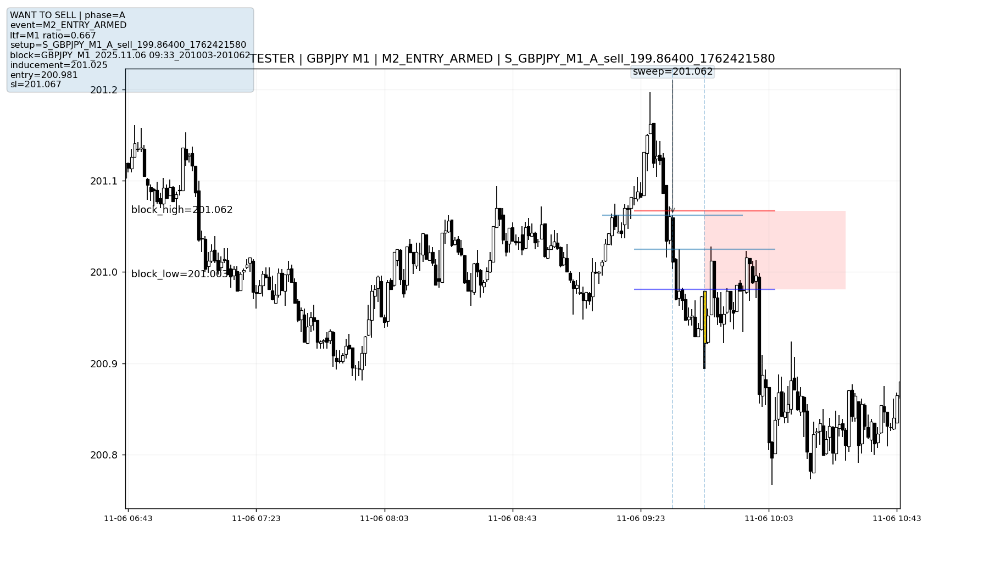
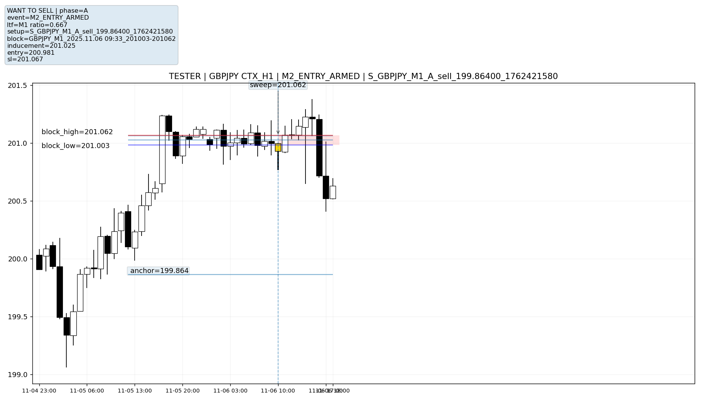

# 02. Investigating Module 2 and Developing Visual Verification

**Focus:** Requirements analysis, testing, data validation and root cause investigation

## The Challenge

Module 2 was the most difficult part of MBFX to develop and test.

While Module 1 focused on identifying and validating important price levels, Module 2 had to recognise the different conditions that could lead to a potential trade. These included changes in market direction, liquidity sweeps, inducements, the formation of trading areas and price returning to those areas. The difficulty was that a valid setup didn't always follow the same sequence. Different market conditions could produce different variations of the same trading opportunity, meaning the detection logic needed to account for several possible scenarios. This made it particularly difficult to translate the original trading rules into code that behaved consistently.

## Three Development Attempts

I rebuilt Module 2 three times while trying to get the detection logic to match the original requirements. Although I could compile and test the code, I repeatedly struggled to establish whether the system was identifying the correct trading behaviour. The numerical logs could tell me that a particular condition had passed, a sweep had been detected or a potential trading area had formed. What they couldn't easily tell me was whether that decision made sense when compared against the actual price movement.

This created a problem with my testing process. I had information about what the system was reporting, but not enough evidence to determine whether those reports were correct.

## Changing the Testing Approach

Rather than continuing to modify the code without fully understanding what was happening, I decided to improve the information available during testing. I directed the development of a Python polling and visual verification system that collected important events from Module 2 and recreated them on historical price charts. This meant I could examine the recorded event, its timing, the price levels involved and the surrounding market conditions together. I could then compare what the system had detected against the original trading requirements, identify questionable decisions and narrow down which part of the logic needed investigating.

The main improvement wasn't that the new tools automatically corrected Module 2. It was that **I now had a way to investigate why the system was behaving differently from what I expected.** This changed how I approached subsequent testing and helped shape the more detailed data collection and reporting tools developed later in the project.

## Visual Verification in Practice

The Python charting system allowed me to examine the same recorded trading setup across different timeframes.

The example below shows a GBPJPY setup that reached the entry preparation stage. Rather than relying solely on the event log, I could inspect the proposed trading area, entry and stop loss levels, and surrounding price movements.

### Detailed View (M1)



### Wider Market Context (H1)



These charts were generated for retrospective testing and include price movements after the recorded event. They allowed me to inspect the detection in context, rather than relying on the numerical logs alone.

Both charts relate to the same recorded setup, but show it from different perspectives. This was useful because Module 2 decisions depended on conditions across multiple timeframes. A detection that appeared reasonable on a one minute chart could still need investigation against the broader market structure. Linking events to charts made it easier to identify questionable detections, inspect event timing and decide which conditions needed further testing.


## Examining the Detection Logic

One of the difficulties with Module 2 was that a setup could pass some conditions but still fail others.

For example, the system needed to establish whether the recent market structure was moving in the intended direction. This involved comparing price movements and checking whether enough of them agreed with that direction. The following extract from the MQL5 alignment check shows how the system calculated a directional agreement ratio and recorded a reason when the condition failed.

```cpp
if(steps == 0)
{
   ar.reason="no_steps";
   return ar;
}

ar.stepRatio = (double)agree / (double)steps;

if(ar.stepRatio < ALIGN_MIN_RATIO)
{
   ar.reason="ratio_fail";
   return ar;
}
```

The purpose of recording a rejection reason was to make failed conditions easier to investigate. Rather than simply reporting that no setup had been found, I wanted to identify which requirement had prevented it from progressing.


## A Recorded Investigation: Limit-side Violations

One of the problems I encountered was Module 2 identifying setups after price had already passed the intended entry level. By the time the setup reached the order preparation stage, the proposed entry was sometimes on the wrong side of the current market price. The system correctly rejected these orders, but I wanted to understand why the earlier detection process had allowed those setups to progress so far.

### The Validation Code

The following extract comes from the Module 4 pre-risk validation logic in MQL5.

```cpp
{
   const bool isBuyPre = (st.intent == "buy");

   MqlTick sideTk;
   if(!SymbolInfoTick(sym, sideTk))
   {
      M4_Reject("no_tick_for_limit_side_check", sym, tf, st, bz, r);
      PrintFormat("[M4] skip: no tick for limit-side check sym=%s tf=%s id=%s",
                  sym, TFtoStr(tf), bz.block_id);
      return;
   }

   const double ptPre = SymbolInfoDouble(sym, SYMBOL_POINT);
   const double sideBufferPts = 1.0;
   bool limitSideOK = true;

   if(isBuyPre)
   {
      // Buy limit must sit below current ask, waiting for price to return down.
      limitSideOK = (entry <= sideTk.ask - sideBufferPts * ptPre);
   }
   else
   {
      // Sell limit must sit above current bid, waiting for price to return up.
      limitSideOK = (entry >= sideTk.bid + sideBufferPts * ptPre);
   }

   if(!limitSideOK)
   {
      M4_Reject("limit_side_violation_pre_risk", sym, tf, st, bz, r);

      BanId(st.banned, st.banned_n,
            M2_SetupLockKey(sym, tf, st.intent, st.anchor.price, st.last_sweep_time),
            TimeCurrent(), 24*60*60);

      SetBlockStatus(bz, "violated", false);

      PrintFormat("[M4-LIMIT-SIDE-DIAG] sym=%s id=%s intent=%s dir=%s entry=%.5f bid=%.5f ask=%.5f low=%.5f high=%.5f status=%s elapsed=%d phase=%s anchor=%.5f",
                  sym, bz.block_id, st.intent, bz.direction, entry,
                  sideTk.bid, sideTk.ask, bz.low, bz.high,
                  bz.setup_status, bz.elapsed_minutes, st.phase, st.anchor.price);

      return;
   }
}
```

*Extract from the original MQL5 source, with one additional diagnostic print statement omitted.*

This check compared the proposed entry against the current bid or ask price. If the entry was no longer valid for a pending limit order, the system recorded a rejection, marked the block as violated and prevented the same setup from being attempted again immediately.

### Evidence from a Historical Test

An example from my `events.ndjson` records shows the following result:

| Recorded field | Value |
|---|---|
| Market | USDJPY |
| Timeframe | M1 |
| Recorded focus time | 20 October 2025, 11:20 |
| Planned entry | 150.681 |
| Setup status | Pending |
| Trading block formed | Yes |
| Rejection event | `M4_REJECT` |
| Rejection reason | `limit_side_violation_pre_risk` |
| Order volume sent | 0 |

The record confirmed that the setup had progressed through earlier checks but was rejected before the order was placed.

### What I Investigated

The rejection itself was correct. The wider issue was the timing of the setup detection. When examining these situations, I needed to establish whether price had already returned to the proposed entry area before Module 2 completed its checks. This meant looking beyond the final rejection reason and examining the sequence of events leading up to it. I used the event records and Python generated charts to compare the reported detection time, trading area and proposed entry against the surrounding price movement. The aim was to distinguish between setups that were still waiting for an entry and those where the opportunity had already passed.

The limit-side check protected the order stage, but it did not establish why the setup had arrived there late. That required further investigation of the earlier Module 2 detection and timing logic. This was one of the reasons visual verification became so important. A rejection code could explain why an order was stopped, but I needed the surrounding data to understand how the system had reached that decision.


## A Recorded Investigation: Rejecting an Outdated Setup

One problem I needed to account for was the system identifying historical price patterns that were no longer relevant when it evaluated them. A historical pattern could satisfy an individual condition without being suitable for a current trading decision. The following example comes from the recorded Module 2 event logs.

| Recorded field | Value |
|---|---|
| Market | EURGBP |
| Timeframe | H4 |
| Event evaluated | 20 October 2025 |
| Original sweep | 15 September 2025 |
| Sweep age | 147 bars |
| Alignment condition | Passed |
| Final result | Rejected |
| Recorded reason | `stale_before_block` |

Although the alignment check passed, the sweep was too old to continue through the setup process. Module 2 recorded the event as `M2_SWEEP_STALE`, followed by `M2_SWEEP_FAILED`. The record also showed that no valid trading block had been formed. This demonstrated why I needed to examine the complete sequence of conditions rather than treating an individual successful check as evidence of a valid setup. It was also useful to retain rejected events in the data. Knowing why a setup failed helped me distinguish between correctly rejected conditions and potential problems with the detection logic.

## Collecting Events with Python

To investigate these decisions, the MQL5 system recorded structured events that could be processed by Python. The following extract from `ai_bridge_watcher.py` shows how the watcher read new event records, attempted to parse them and passed valid records to the event processing function.

```python
for line in f:
    line = line.strip()
    if not line:
        continue
    data = parse_event_line(line)
    if data is None:
        preview = _clean_line(line)[:260].replace("\t", " ")
        print(f"[PY] Failed to parse NDJSON line from {path}: preview={preview} ...")
        continue
    process_event_dict(data, source_path=path)
```

This allowed me to collect information from the testing system without manually reviewing every line of the MetaTrader logs. The event data could then be used to build research records and produce annotated charts, helping me investigate what the system had detected and why it had made a particular decision. Importantly, visual verification did not eliminate the problems with Module 2. It gave me better evidence for investigating them and deciding what needed to be changed.

